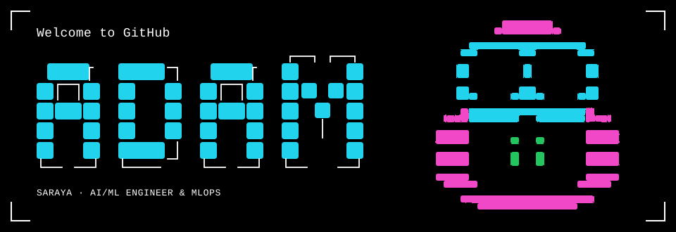
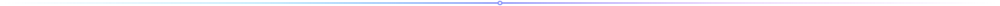

  

  

  
  
  
  

  

## 🚀 About Me

<table>
  <tr>
    <td width="65%" valign="top">
      

        I engineer <strong>AI-powered applications</strong> and the <strong>production infrastructure</strong> that brings them to scale. My work spans machine learning pipelines, LLM applications, low-latency model deployment, distributed systems, and cloud-native backend engineering.
      

      

        I am particularly passionate about <strong>production ML systems, AI infrastructure, inference optimization, and scalable system architectures</strong>—building systems that are not just theoretically sound, but resilient, observable, and cost-effective under real-world workloads.
      

      <ul>
        <li>🔭 <strong>Focus Areas:</strong> Production ML, Agentic Architectures (LangGraph), Scalable Inference &amp; MLOps</li>
        <li>⚡ <strong>Engineering Philosophy:</strong> Clean system abstractions, lock-free concurrency, reproducible pipelines &amp; telemetry-first observability</li>
        <li>🌱 <strong>Currently Exploring:</strong> vLLM / TensorRT-LLM optimization, distributed KV-caching &amp; autonomous agent reliability</li>
      </ul>
    </td>
    <td width="35%" align="center" valign="middle">
      
       
      <em>Autonomous Intelligence &amp; Distributed Systems</em>
    </td>
  </tr>
</table>

  

## 🛠️ Technical Expertise

  

 

<table>
  <thead>
    <tr>
      <th width="32%">Domain</th>
      <th width="68%">Technologies, Tools &amp; Frameworks</th>
    </tr>
  </thead>
  <tbody>
    <tr>
      <td>
        <strong>🧠 AI &amp; Machine Learning</strong>
      </td>
      <td>
        
        
        
        
        
         
        <em>Transformers · Computer Vision · NLP · Model Fine-tuning · Vector Embeddings · RAG Pipelines</em>
      </td>
    </tr>
    <tr>
      <td>
        <strong>🤖 LLMs &amp; Agentic Systems</strong>
      </td>
      <td>
        
        
        
        
         
        <em>Autonomous AI Agents · Tool Calling · Structured Outputs · Semantic Search · Multi-Agent Orchestration</em>
      </td>
    </tr>
    <tr>
      <td>
        <strong>☁️ MLOps &amp; Infrastructure</strong>
      </td>
      <td>
        
        
        
        
        
        
        
        
        
        
         
        <em>CI/CD Automation · Model Monitoring · Autoscaling · High-Availability Deployments</em>
      </td>
    </tr>
    <tr>
      <td>
        <strong>⚡ Backend &amp; Systems Engineering</strong>
      </td>
      <td>
        
        
        
        
        
         
        <em>REST APIs · Sharded Caching · Concurrent Programming · Distributed Systems · Request Coalescing</em>
      </td>
    </tr>
  </tbody>
</table>

  

## 🔬 Featured Engineering Projects

<table>
  <tr>
    <td width="65%" valign="top">
      <h3>⚡ <a href="https://github.com/adam-Sar/precog">Precog — Predictive HTTP Caching for Go</a></h3>
      

        High-performance caching middleware designed for Go services requiring sub-millisecond tail latencies. Built with lock-free atomic memory access, sharded memory storage, request coalescing (single-flight deduplication), and Markov-chain-based predictive prefetching.
      

      

        
        
        
        
      

      <ul>
        <li><strong>Markov Chain Engine:</strong> Dynamically predicts subsequent HTTP queries based on historical route transition matrices to warm cache lines ahead of time.</li>
        <li><strong>Request Coalescing:</strong> Prevents cache stampedes under high concurrency by collapsing duplicate downstream requests into single in-flight fetches.</li>
      </ul>
    </td>
    <td width="35%" align="center" valign="middle">
      
    </td>
  </tr>
</table>

 

<table>
  <tr>
    <td width="35%" align="center" valign="middle">
      
    </td>
    <td width="65%" valign="top">
      <h3>🛡️ triageIQ — Agentic Incident Investigation</h3>
      

        An autonomous, AI-driven incident investigator that ingests real-time system health metrics, Kubernetes cluster logs, Grafana alerts, and infrastructure signals to isolate root causes and formulate automated remediation runbooks.
      

      

        
        
        
        
      

      <ul>
        <li><strong>Multi-Agent State Graph:</strong> Employs stateful LangGraph workflows with specialized agent nodes for triage, log correlation, metric anomaly detection, and resolution synthesis.</li>
        <li><strong>Dynamic Tool Calling:</strong> Autonomously queries Kubernetes APIs and observability backends with structured verification steps to eliminate hallucinated diagnoses.</li>
      </ul>
    </td>
  </tr>
</table>

 

<table>
  <tr>
    <td width="65%" valign="top">
      <h3>🌐 SafeWay — AI-Powered Threat Classification</h3>
      

        A production-grade, multilingual threat intelligence ingestion pipeline leveraging fine-tuned DeBERTa models to classify, prioritize, and process high-throughput global news feeds and threat vectors in real time.
      

      

        
        
        
        
      

      <ul>
        <li><strong>Fine-Tuned DeBERTa-v3:</strong> Customized and quantized transformer architecture optimized for domain-specific taxonomy classification across multiple languages.</li>
        <li><strong>Resilient ML Pipeline:</strong> Built with robust data validation, automated preprocessing, batching inference, and low-latency API endpoints.</li>
      </ul>
    </td>
    <td width="35%" align="center" valign="middle">
      
    </td>
  </tr>
</table>

  

## 🎯 Engineering Interests

  <table>
    <tr>
      <td width="50%">
        <strong>⚡ Production ML &amp; Inference Optimization</strong> 
        Quantization (AWQ/GPTQ), continuous batching, speculative decoding, and low-latency inference serving with vLLM &amp; TensorRT.
      </td>
      <td width="50%">
        <strong>☁️ MLOps &amp; Resilient Infrastructure</strong> 
        Kubernetes cluster orchestration, autoscaling with KEDA, feature store design, CI/CD automation, and deployment reproducibility.
      </td>
    </tr>
    <tr>
      <td width="50%">
        <strong>🔀 Distributed Systems &amp; Concurrency</strong> 
        High-throughput Go services, lock-free data structures, predictive caching algorithms, and fault-tolerant message queues.
      </td>
      <td width="50%">
        <strong>🤖 Autonomous Agents &amp; RAG Architecture</strong> 
        Multi-agent state machines, structured tool calling, guardrails, vector embeddings, and hybrid semantic retrieval.
      </td>
    </tr>
  </table>

  

## 📊 GitHub Telemetry

  
  &nbsp;&nbsp;
  

 

  

  

## 🤝 Let's Connect &amp; Collaborate

  I am always keen to exchange ideas on <strong>production ML architectures, agentic systems, infrastructure scalability, and open-source tooling</strong>.

  
  &nbsp;
  
  &nbsp;
  

  Designed with precision for engineering excellence • <a href="https://github.com/adam-Sar">adam-Sar</a>

